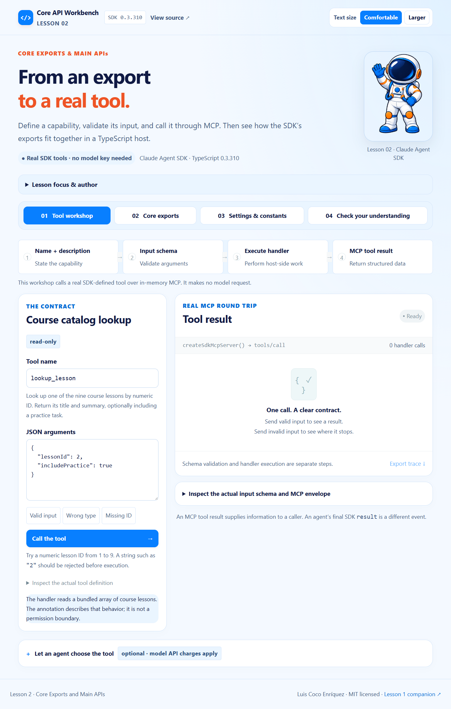
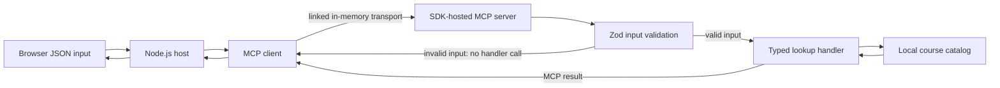

# Lesson 02 · Core API Workbench

**A hands-on companion to “Claude Agent SDK TypeScript version 0.3.310” by Luis Coco Enríquez.**

Build on [Lesson 1's Agent Lab](https://github.com/luiscoco/claude-agent-sdk-lesson-01): define a useful capability, validate its arguments, expose it through MCP, and understand which SDK export performs each job.



## Run the sample

You need **Node.js 22.14+**, npm, and Git. No model account or API key is needed for the tool workshop, settings preview, constants, or quiz.

```sh
git clone https://github.com/luiscoco/claude-agent-sdk-lesson-02.git
cd claude-agent-sdk-lesson-02
npm ci
npm run dev
```

Open **http://127.0.0.1:4321** and click **Call the tool**.

This is a **real SDK-defined tool and a real MCP initialize/list/call round trip**, using linked in-memory transports. It is not a simulated model response. The caller selects the tool directly; no Claude query or model billing occurs in the default workshop. The installed SDK is exactly **0.3.310**.

## Follow the four activities

1. **Tool workshop:** send `{ "lessonId": 2, "includePractice": true }`. Inspect the tool description, discovered JSON schema, execution steps, handler counter, and MCP result.
2. **Break the contract:** try `{ "lessonId": "2" }` or omit the ID. The actual MCP server rejects invalid arguments before the handler runs. Compare zero handler calls with a successful call's one invocation.
3. **Core exports:** group APIs into running, preparation, extension, configuration, and lookup responsibilities. Inspect their actual runtime types and alpha labels.
4. **Settings & constants:** run the configuration helpers against a controlled fixture; look up `Task` and see its canonical `Agent` alias. Complete the four-question knowledge check.

See [the classroom walkthrough and answer guide](docs/lesson-2-walkthrough.md) for exercises aligned with the lesson.

## The custom tool contract

In SDK **0.3.310**, `tool()` uses positional arguments:

```ts
import { tool } from '@anthropic-ai/claude-agent-sdk';
import { z } from 'zod';
import { LESSONS } from './src/server/catalog.js';

const lookup = tool(
  'lookup_lesson',
  'Look up a course lesson by numeric ID.',
  {
    lessonId: z.number().int().min(1).max(9),
    includePractice: z.boolean().default(false),
  },
  async ({ lessonId, includePractice }) => {
    const lesson = LESSONS.find((item) => item.id === lessonId)!;
    const data = {
      title: lesson.title,
      summary: lesson.summary,
      ...(includePractice ? { practice: lesson.practice } : {}),
    };
    return { content: [{ type: 'text', text: JSON.stringify(data) }] };
  },
);
```

The fragment above illustrates the signature; the complete runnable implementation is [src/server/course-tool.ts](src/server/course-tool.ts). Its handler returns both text content and structured lesson data. It only reads the bundled course catalog. `readOnlyHint` describes this behavior; annotations do not enforce a permission boundary.

The name and description help a caller or model select a capability. The Zod schema validates input. The handler performs host-side work. An MCP tool result supplies data to a caller; an agent query's final SDK `result` is a separate outcome.

## How the actual MCP call works



[src/server/invoke.ts](src/server/invoke.ts) connects an actual MCP client to `createSdkMcpServer().instance`, discovers the tool with `tools/list`, and calls it with `tools/call`. Both client and server close in `finally`. Calling a handler directly would bypass the protocol's input-validation path, so the workshop intentionally exercises the MCP boundary.

## What each export does

| Responsibility | Export                                  | Sample feature                                         |
| -------------- | --------------------------------------- | ------------------------------------------------------ |
| Run            | `query()`                               | Optional live agent query and streamed results         |
| Prepare        | `startup()`                             | Known session → `WarmQuery` → `.query(prompt)`         |
| Prepare        | `prewarm()` (alpha)                     | Parked `SpareProcess` → later `.claim(...)`            |
| Extend         | `tool()`                                | Typed course lookup contract                           |
| Extend         | `createSdkMcpServer()`                  | Host the tool behind MCP                               |
| Configure      | `resolveSettings()` (alpha)             | Inspect merged settings for the controlled fixture     |
| Configure      | `filterEscalatingDefaultMode()` (alpha) | Apply the SDK's project-tier default-mode trust filter |
| Look up        | `BUILTIN_TOOL_NAMES`                    | Inspect built-in names as data                         |
| Look up        | `LEGACY_TOOL_NAME_ALIASES`              | Resolve compatibility names such as `Task → Agent`     |

The export catalog verifies availability and runtime type against the installed module. Status notes follow the course guide and the matching 0.3.310 declarations. Pinning an alpha API does not make it stable.

The preparation examples are compile-checked entry points in [src/examples/preparation.ts](src/examples/preparation.ts). The browser explains their lifecycle and **does not execute preparation or benchmark latency**. `startup()` and `prewarm()` return different handles; callers must close unused handles and handle spare-process claim rejection. Begin with `query()` before adding runtime preparation.

## Settings inspection is not a permission decision

The fixture at `fixtures/settings-project/.claude/settings.json` requests `acceptEdits` from the project tier. The real `resolveSettings()` helper reports the raw cascade. `filterEscalatingDefaultMode()` drops an escalating mode contributed by the repo-committed project tier.

The preview returns only mode values, source names, and an explanation. It never sends raw settings, environment values, or local file paths to the browser. Machine-managed policy can affect the merge. The preview does not mutate configuration or apply the fixture's mode to a query.

The constants are separate lookup data: they are not callable APIs and do not establish tool availability in a running session. MCP tools have their own namespaced identifiers.

## Optional: let Claude select the tool

Copy `.env.example` to `.env`, set your own `ANTHROPIC_API_KEY`, and restart the server. On Windows PowerShell use `Copy-Item .env.example .env`; on macOS/Linux use `cp .env.example .env`.

Open **Let an agent choose the tool** and run the prompt. This path makes billable model requests and registers a fresh SDK-hosted server:

```ts
const q = query({
  prompt,
  options: {
    tools: [],
    mcpServers: { course: createCourseServer() },
    allowedTools: ['mcp__course__lookup_lesson'],
    permissionMode: 'dontAsk',
    settingSources: [],
    persistSession: false,
    maxTurns: 4,
    maxBudgetUsd: 0.25,
  },
});
```

The registration key **`course`** produces the query tool name **`mcp__course__lookup_lesson`**. The server's descriptive name is `course-catalog`. Built-in tools are disabled; the custom handler only reads the local course catalog. `allowedTools` auto-approves that precise MCP tool; it is not a general availability restriction. The full [live adapter](src/server/live.ts) also forwards cancellation and closes the query and hosted server.

The local host binds to `127.0.0.1`, rejects cross-origin POSTs, and applies a 90-second timeout to live queries. Keep API keys on the server. This is a local teaching application, not a hosted public model proxy. Live mode deliberately skips project/user setting sources, so the inspection fixture's requested `acceptEdits` mode is not used for that query.

Live mode is type-checked against the installed SDK and tested with injected query handles. Actual model execution requires a learner's own key. The default tests and real in-memory tool calls do not make model requests.

## Small command-line examples

```sh
npm run tool:demo       # real MCP call for Lesson 2, no model
npm run tool:demo -- 6  # look up another lesson
npm run exports         # actual runtime exports and constants
npm run settings        # real helpers; selected mode fields only
npm run live:cli        # real model query; needs your server API key
```

Import examples for the root package, `/core`, and the type-only `/sdk-tools` entry are compile-checked in [src/examples/imports.ts](src/examples/imports.ts).

## Verify and build

```sh
npm run check
npm start
```

The production app runs at **http://127.0.0.1:4321**. Browser tests build and start their own production test server on port **4322**:

```sh
npx playwright install chromium
npm run test:e2e
```

On Linux, Playwright may need `npx playwright install --with-deps chromium`. GitHub Actions runs checks on Node.js 22 and 24 plus a Chromium browser suite. Tests cover real MCP validation and defaults, all catalog IDs, isolated handlers, settings filtering, server request boundaries, and the optional live adapter without model calls.

## Source map

- [course-tool.ts](src/server/course-tool.ts): the tool contract and SDK-hosted server.
- [invoke.ts](src/server/invoke.ts): real in-memory MCP client/server lifecycle.
- [exports.ts](src/server/exports.ts): runtime export inspection and teaching notes.
- [settings.ts](src/server/settings.ts): real configuration helpers with a restricted response.
- [live.ts](src/server/live.ts): optional model query with the registered custom tool.
- [src/examples](src/examples): small examples to read alongside the video.

## References and version context

- [Official TypeScript SDK reference](https://code.claude.com/docs/en/agent-sdk/typescript)
- [SDK 0.3.310 release notes](https://github.com/anthropics/claude-agent-sdk-typescript/releases/tag/v0.3.310)
- [Model Context Protocol TypeScript SDK](https://github.com/modelcontextprotocol/typescript-sdk)
- Installed `sdk.d.ts`, particularly `tool`, `startup`, `prewarm`, `resolveSettings`, and `filterEscalatingDefaultMode`.

Documentation evolves; this sample's code contract is the pinned 0.3.310 package. The runnable tool uses `tool(name, description, schema, handler, extras?)` and an MCP result envelope, matching that version's declarations.

MIT © Luis Coco Enríquez. Independent educational sample; not an official Anthropic product.

See [visual style and reading controls](docs/visual-style.md) for the refreshed reference palette, larger typography, and persistent text-size setting.
